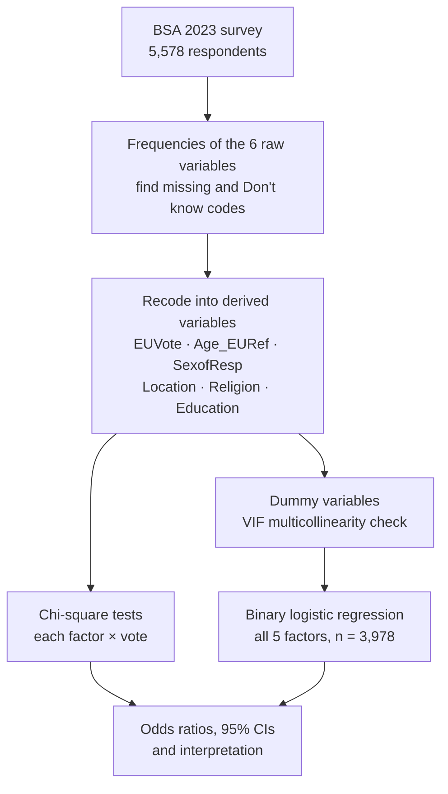

# Who Voted Leave? Demographics and the 2016 EU Referendum

**How age, sex, region, religion and education relate to the 2016 UK EU Referendum vote: chi-square tests and binary logistic regression in SPSS on 4,111 voters from the British Social Attitudes Survey 2023.**


MSc Data Science, University of Sheffield (2026) · Module: IJC466 Data Analysis · **Awarded 72% (Distinction)** · Author: **Cailey Coghlan**

📄 [Read the full report (PDF)](docs/report.pdf) · 🧾 [View the SPSS syntax](syntax/analysis.sps) · 📊 [Browse the result tables](results/) · 🗃️ [Get the dataset](data/Data_Analysis_Project.sav)

---

## Project summary

### The problem
The United Kingdom left the European Union on 31 January 2020, and estimates put the cumulative cost at a 6–8% loss of GDP by 2025. Understanding *who* voted Leave helps explain how the decision came about. Past studies agree that age, education and region mattered, but the role of **religion** in the vote has been under-researched.

This study set out to evaluate the relationship between five demographic factors (age, sex, region, religion and educational qualifications) and how people voted in the 2016 referendum.

### What I did
I used the **British Social Attitudes Survey 2023** (National Centre for Social Research), a survey of 5,578 adults in England, Scotland and Wales, of whom 4,174 were asked how they voted in 2016. In **IBM SPSS Statistics** I:

1. **Cleaned and recoded the six survey variables.**
   - I turned the vote into a binary outcome (0 = Remain, 1 = Leave).
   - I rebuilt each respondent's **age at the time of the referendum** by subtracting seven years from their 2023 age. I then grouped it into five bands and excluded 314 people who were too young to vote in 2016.
   - I collapsed 11 regions into 6 groups, and reordered religion and education so the reference groups (No religion, Degree) come first.
   - I excluded "Don't know" and "Prefer not to answer" responses from every variable.
2. **Tested each factor on its own** with chi-square tests of independence (each demographic factor × vote).
3. **Checked for multicollinearity** with variance inflation factors before modelling. Every VIF was below 3.
4. **Modelled all five factors together** with a binary logistic regression (n = 3,978). This gave odds ratios for each group compared with a reference group, controlling for the other demographics.

### What I found
- **All five factors were significantly associated with the vote.** Each remained significant after controlling for the others in the logistic regression.
- **Education had the strongest association.** Respondents with no qualifications had **5.8 times the odds** of voting Leave compared with degree holders (OR = 5.831, 95% CI 4.41–7.71). The odds rose steadily at every step down in qualification level.
- **Region came next.** Residents of the Midlands and the East of England had **twice the odds** of voting Leave compared with Londoners (OR = 2.103). **Scotland was the only region less likely to vote Leave** than London (OR = 0.661).
- **There was a clear generational divide.** Respondents aged 65+ in 2016 had **twice the odds** of voting Leave compared with 18–24 year olds (OR = 2.057). 80.2% of 18–24s voted Remain, while 51.6% of over-65s voted Leave.
- **Religion mattered, which helps fill the research gap.** Anglicans had **1.7 times the odds** of voting Leave compared with non-religious respondents (OR = 1.716). Other Christians were also more likely to vote Leave (OR = 1.587).
- **Sex had the weakest association.** Men had 20% higher odds of voting Leave than women (OR = 1.200, p = .011).
- **Demographics explain part of the vote, not all of it.** The model explained about 20% of the variation in voting outcome (Nagelkerke R² = .199).

### Why it matters
The results confirm that education, age and region were central to the Brexit vote. They also show that Anglican identity was linked to voting Leave, a link that has received little research attention. Scotland's strong Remain vote suggests that national identity and culture, not economic deprivation alone, shaped how regions voted. The remaining 80% of unexplained variation points to factors this model did not test, such as ethnicity and political attitudes.

---

## Key results

### Each factor on its own: chi-square tests of independence

| Factor | Groups | n | χ² (Pearson) | df | p | Strongest pattern |
|---|---|---|---|---|---|---|
| Highest qualification | 5 | 4,035 | 445.58 | 4 | <.001 | Degree: 77.4% Remain · No qualifications: 65.5% Leave |
| Age at 2016 referendum | 5 | 4,070 | 128.99 | 4 | <.001 | 18–24: 80.2% Remain · 65+: 51.6% Leave |
| Religion | 5 | 4,083 | 110.44 | 4 | <.001 | No religion: 68.4% Remain · Anglican: 51.8% Leave |
| Region | 6 | 4,111 | 107.21 | 5 | <.001 | Scotland: 78.5% Remain · Midlands & East: 46.4% Leave |
| Sex | 2 | 4,111 | 5.18 | 1 | .023 | Female: 63.1% Remain · Male: 59.7% Remain |

*The table shows Pearson chi-square for every factor. For age and education, the report quotes SPSS's linear-by-linear trend test (χ² = 125.08 and 433.61, df = 1), which tests the ordered trend across groups. For sex, it quotes the continuity-corrected value (χ² = 5.03, p = .025). Every version is significant. All the statistics are in [`results/03_chi_square_tests.csv`](results/03_chi_square_tests.csv), and the full group-by-vote breakdown is in [`results/02_vote_by_group_crosstabs.csv`](results/02_vote_by_group_crosstabs.csv).*

### All factors together: binary logistic regression

Outcome: voted Leave (1) vs Remain (0) · n = 3,978 · Nagelkerke R² = .199 · Model χ²(18) = 631.05, p < .001

| Factor (reference group) | Group | Odds ratio (95% CI) | p |
|---|---|---|---|
| **Education** (Degree or above) | Other higher education (HNC, HND) | 2.240 (1.829–2.742) | <.001 |
| | A-levels or equivalent | 3.229 (2.595–4.016) | <.001 |
| | Below A-levels (GCSE or equivalent) | 4.277 (3.538–5.170) | <.001 |
| | No qualifications | **5.831** (4.411–7.708) | <.001 |
| **Region** (London) | South East & South West England | 1.555 (1.163–2.078) | .003 |
| | Midlands & East of England | **2.103** (1.577–2.804) | <.001 |
| | North of England & Yorkshire | 1.570 (1.176–2.095) | .002 |
| | Wales | 1.516 (1.017–2.261) | .041 |
| | Scotland | **0.661** (0.459–0.950) | .025 |
| **Age in 2016** (18–24) | 25–34 | 1.349 (0.962–1.891) | .082 |
| | 35–50 | 1.646 (1.204–2.250) | .002 |
| | 51–64 | 1.536 (1.125–2.098) | .007 |
| | 65+ | **2.057** (1.473–2.873) | <.001 |
| **Religion** (No religion) | Non-Christian | 1.192 (0.832–1.709) | .338 |
| | Other Christian | 1.587 (1.332–1.891) | <.001 |
| | Roman Catholic | 1.221 (0.922–1.616) | .164 |
| | Church of England / Anglican | **1.716** (1.400–2.102) | <.001 |
| **Sex** (Female) | Male | 1.200 (1.042–1.382) | .011 |

*An odds ratio above 1 means higher odds of voting Leave than the reference group, and below 1 means lower odds. B, standard errors and Wald statistics are in [`results/05_logistic_regression_odds_ratios.csv`](results/05_logistic_regression_odds_ratios.csv).*

**Model checks**

- **Multicollinearity:** the highest VIF is 2.81, well below the usual threshold of 5. See [`results/04_multicollinearity_vif.csv`](results/04_multicollinearity_vif.csv).
- **Classification:** at a 0.5 cut-off the model classifies 69.3% of voters correctly, against a 61.8% baseline of predicting Remain for everyone. It identifies 80.9% of Remain voters but only 50.6% of Leave voters. The model is built to explain associations rather than to predict votes, and this is consistent with an R² of about 0.2. See [`results/06_logistic_regression_model_fit.csv`](results/06_logistic_regression_model_fit.csv).

---

## How the analysis works



### Key decisions in the data preparation

| Decision | Why |
|---|---|
| **Subtracted 7 years from age** | The survey records age in 2023, but the vote was in 2016. Without this, the age groups would describe people seven years older than they were when they voted. |
| **Excluded 314 respondents aged 22–24 in 2023** | They were under 18 in 2016 and could not vote. Ages are top-coded at 22 ("18–22"), so every respondent aged 24 or younger in 2023 was excluded. |
| **Merged 11 regions into 6** | This keeps groups large enough for stable estimates. Scotland and Wales stay separate as distinct nations. |
| **Chose reference groups deliberately** | The reference groups are the youngest voters, the highest qualification, the capital, no religion, and female. Most of these are among the strongest Remain groups, so most odds ratios are above 1 and read as "how much more likely to vote Leave than…". |
| **Excluded "Don't know" and "Prefer not to answer"** | They don't fit an ordered or binary scale. Exclusion counts are recorded for each variable in [`results/01_sample_descriptives.csv`](results/01_sample_descriptives.csv). |

---

## Limitations and next steps

- **There is a seven-year gap.** The survey was run in 2023, so region and education are measured in 2023, not 2016. Some respondents will have moved or gained qualifications since they voted.
- **Northern Ireland isn't covered.** The BSA covers Great Britain only, so the results don't represent the whole 2016 electorate.
- **There is limited diversity in the sample.** Most respondents were White British and either non-religious or Christian, so the non-Christian group is small (n = 176 voters).
- **The data is unweighted and self-reported.** The analysis uses unweighted counts, and recalled votes from seven years earlier may be affected by memory or social desirability. The NatCen user guide recommends weighting with `BSA23_final_wt`, which adjusts for non-response and matches the sample to the population on age, sex, education, tenure, ethnicity, economic activity and region.
- **Next steps:**
  - Add ethnicity, political leaning and attitudes to immigration to the model.
  - Test interactions, such as whether the age gap differs by education.
  - Rerun the model with the survey weight `BSA23_final_wt`.

---

## Repository structure

```
eu-referendum-voting-demographics/
├── README.md                          # this page
├── syntax/
│   └── analysis.sps                   # SPSS syntax: recodes, chi-square, VIF, logistic regression
├── output/
│   └── Data_Analysis_Project.spv      # the original SPSS output (all tables and charts)
├── results/                           # every result table, as CSV
├── data/
│   └── Data_Analysis_Project.sav      # BSA 2023 dataset, with my derived variables added
└── docs/
    ├── report.pdf                     # the full report
    ├── FILE_GUIDE.md                  # what every file is
    ├── BSA_2023_user_guide.pdf        # NatCen's survey documentation
    └── BSA_2023_cheat_sheet.docx      # module guide to the dataset's variables
```

**Guide to every file:** [docs/FILE_GUIDE.md](docs/FILE_GUIDE.md)

---

## How to run

Everything needed to reproduce the analysis is in this repository.

1. **Download the repository.** Click the green **Code** button, then **Download ZIP**, and unzip it.
2. **Open the data in SPSS.** Go to **File → Open → Data** and select `data/Data_Analysis_Project.sav`.
3. **Run the syntax.** Go to **File → Open → Syntax**, choose `syntax/analysis.sps`, then click **Run → All**. It rebuilds the derived variables from the original survey variables and produces every table in the report.

The dataset already contains the derived variables, so you can also run the analyses in sections 3–5 of the syntax on their own.

You can view the results without SPSS. The tables are in `results/`, and the full output is reproduced in the report's appendix.

---

## Tech stack

**Software:** IBM SPSS Statistics 31 (Frequencies, Recode, Crosstabs, Linear Regression for collinearity diagnostics, Binary Logistic Regression)

**Skills shown:** survey data cleaning and recoding · handling missing and non-substantive responses · deriving variables from domain reasoning (age at the time of an event) · chi-square tests of independence · multicollinearity diagnostics · binary logistic regression with categorical predictors · interpreting odds ratios and confidence intervals · reproducible syntax · linking statistical results to published literature

---

## Data source

National Centre for Social Research. (2024). *British Social Attitudes Survey, 2023* [Data collection]. UK Data Service. SN: 9363. [https://doi.org/10.5255/UKDA-SN-9363-1](https://doi.org/10.5255/UKDA-SN-9363-1)

The dataset in [`data/`](data/Data_Analysis_Project.sav) is the version of the survey provided for the module (5,578 respondents, 405 variables), with my 34 derived variables added. The variables used and how each was derived are listed in the [file guide](docs/FILE_GUIDE.md#data). NatCen's [user guide](docs/BSA_2023_user_guide.pdf) explains how the survey was sampled, run and weighted.

Ratti, V., Stevenson, I. & Maplethorpe, N. (2024). *British Social Attitudes: User Guide.* National Centre for Social Research.

---

## Contact

**Cailey Coghlan**, MSc Data Science, University of Sheffield
[LinkedIn](https://www.linkedin.com/in/cailey-coghlan-10a8a8173/) · [Email](mailto:caileycog@outlook.com)

**More projects:**
- [Psoriasis Biomarker Discovery](https://github.com/caileycog/psoriasis-biomarker-discovery): R, limma, nested CV, SHAP
- [Airline Passenger Satisfaction](https://github.com/caileycog/airline-passenger-satisfaction): KNIME, logistic regression vs gradient boosted trees
- [Big Data Analysis of ICLR Submissions](https://github.com/caileycog/iclr-submissions-big-data-analysis): PySpark, Databricks, Spark MLlib
